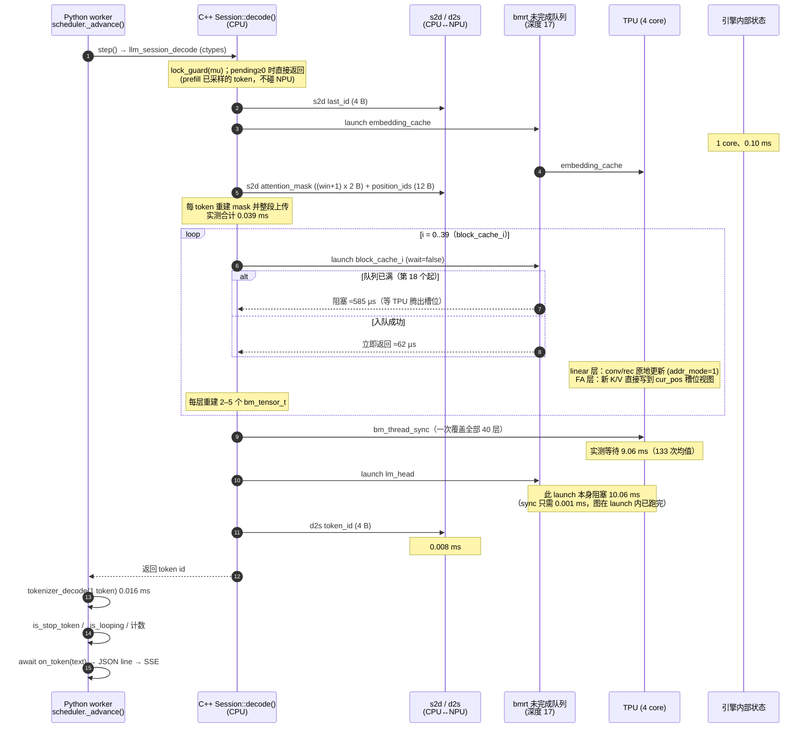

# 35B-A3B decode 阶段：全流程数据、算子与优化路径

| 项目 | 内容 |
|---|---|
| **历史结论** | 一个 token 是「固定 27.0 ms + 10 × FA 层开销」；并发只有靠时间片才能不加总延迟；`lm_head` 占 30% 且只能靠改 bmodel 优化；提交/同步已到运行时上限 |
| **当前约束** | 调度时间片默认 **8** token（`--decode-quantum 1` 可回退），见 `docs/DESIGN.md` §4；引擎图、KV、数值语义未改；`lm_head` 与队列方向未再投入 |
| **本篇保留** | 逐 token 的 42 次发射拆分、成本模型、探针与原始数据指针——用于判断后续优化是否还有空间 |

> 子任务 MYS-2457（父 MYS-2293）。基线 `main` v0.6.9 `a4c07a1`，分支 `research/decode-pipeline`。
> 本文只做分析与测量：**未改动引擎、未改数值/图语义、未 bump 版本、未发版**。
> 所有数字都在 `10.42.0.242`、Qwen3.6-35B-A3B **128k** bmodel、
> `qwen3.6-35b-a3b-int4-autoround_w4bf16_seq131072_bm1684x2_4core_history_dynamic_20261025_051759.bmodel`
> 上实测。复现脚本与原始数据见 [`analysis/README.md`](../../analysis/README.md)。

## 0. 结论先行

1. **decode 的耗时结构是「固定 27.0 ms + 10 × 单个 FA 层的注意力开销」，已用 4 个上下文长度验证到 ±0.2 ms。**
   短上下文 33.4 ms/token（29.9 tok/s），17k 上下文 46.4 ms/token（21.5 tok/s）。
2. **`lm_head` 单图占 10.06 ms，是每 token 的 30%（短上下文）到 22%（17k 上下文）。** 它的耗时就是「把 1017.1 MB 权重读一遍」，
   等效 101 GB/s，由访存带宽决定。任何主机侧改动都省不掉它；只有改 bmodel（降低 `lm_head` 精度 /
   缩小候选词表）或由厂商换融合方式才能动。
3. **`bmrt_launch_tensor_ex` 的未完成队列只有 17 个。** 第 18 个 launch 开始每次阻塞约 585 µs
   （≈ 一层的 TPU 时间）。也就是说：MYS-2377 的「40 层连续提交 + 一次 sync」在这一层上**已经触到上限**，
   实测 submit 13.6 ms = 17×62 µs + 23×585 µs。再往「更少同步、更多流水」方向做的空间是零，
   除非减少图的个数（bmodel 改动）。
4. **当前调度器的前提是错的，而且代价可测：并发不增加总吞吐，反而降到 0.71×。**
   1 会话 29.9 tok/s；2 会话合计 21.3（0.71×）；3 会话合计 21.4（0.71×）。
   根因是每次切换会话要 park/unpark **34.7 MB** 线性状态（实测 48 次 decode 产生 3.43 GB d2d，
   解析预测 3.38 GB）。**把时间片从 1 token 提到 8 token，合计吞吐恢复到 0.94×（2048 上下文：0.69×→0.93×）**，
   这是纯 Python 改动、不改任何数值。
5. **主机侧开销可以忽略**：mask+pos 上传 + token 回读每 token 共 0.05 ms，分词 0.016 ms。
   把 Python/tokenizer/SSE 当作 decode 瓶颈去优化，收益上界是 0.15%。
6. 需要厂商提供的数据（否则算子级优化无法定量）：fused graph 内的算子级 trace、每次 DMA/launch 的
   真实延迟、以及未完成队列深度能否配置。见 §7。

## 1. 逐 token 时序与责任划分

一个 `Session::decode()`（`native/src/llm_engine.cpp:1293`）在 TPU 侧是 **42 个 graph launch**：

- 1 × `embedding_cache`（`input_ids[1,1]` → `embedding_cache[1,1,2048]`，core num 1）
- 40 × `block_cache_<i>`（30 个 linear attention + 10 个 full attention，见 §2）
- 1 × `lm_head`（`hidden_states[1,2048]` → `token_id[1,1]` int32，argmax 已融合）



责任划分（实测或读码可证）：

| 阶段 | 执行者 | 实测耗时/token | 证据 |
|---|---|---|---|
| `last_id` 上传、mask/pos 上传 | CPU→NPU | 0.039 ms | `bmprof` s2d：4098 B 均值 24.6 µs、12 B 14.4 µs，每 token 各一次 |
| `embedding_cache` | TPU | 0.039 ms | `bmprof`：128 次 launch 均值 38.6 µs（`graph_probe` 隔离测 0.10 ms，含固定开销） |
| 40 层 chain submit | CPU | 13.6 ms | `bmprof`：40 × launch 的 CPU 时间 |
| 40 层 chain 退役 | TPU | 9.06 ms | `bmprof`：每 token 那次 `bm_thread_sync` 133 次，均值 9.06 ms（8.60–9.25） |
| `lm_head` | TPU（阻塞在 launch 内） | 10.06 ms | `graph_probe --net lm_head`；`probe_lm` 连续两次 launch 各 10.0 ms |
| token 回读 | NPU→CPU | 0.008 ms | `bmprof` d2s：4 B，129 次均值 8.2 µs |
| 分词 | CPU | 0.016 ms | `tokdec_probe.py`：3000 次均值 15.5 µs |
| mask 重建（每 token 新建 buffer） | CPU | 含在上行 0.039 ms 内 | `llm_engine.cpp:814-817` 每次新建 `std::vector<uint16_t>` |
| 会话调度 / park / unpark | CPU + D2D | 仅并发时，34.7 MB/切换 | §5.1 |
| SSE / JSON 行 | CPU（asyncio） | 未单独测量 | 见 §4.5 的估计与界 |

**没有任何一层做 host 往返。** 层间通过 `blocks_cache[i].stages[0].output_mems[0]` 在设备内存里传递
hidden state（`llm_engine.cpp:825` 取 `st.output_mems[0]`、`:863` 把它交给下一层），
这一点用绝对地址探针确认：`block_cache_0` 的
`in0 == out0 == 0x1178062000`。所谓「每层无意义 host 往返」在当前实现里**不存在**——
MYS-2377 已经把 sync 从 24 次/token 降到 1 次。

## 2. 图与数据布局

### 2.1 结构（`model_tool --info`，已核实）

bmodel 共 94 个 net：`vit` + `embedding` + `lm_head` + `embedding_cache` + `block_cache_0..39`
+ `block_0..39` + `block_kv_3/7/…/39`（10 个 history FA 预填充图）。

| 项 | 值 | 来源 |
|---|---|---|
| decode 层数 | 40 | net 名 `block_cache_0..39` |
| FA 间隔 | 每 4 层一个（第 3、7、…、39 层，共 10 个） | net 名 + `kFaInterval`（`llm_engine.cpp:53`）；`config.json` `layer_types` 同构 |
| 线性层 | 30 个 | 40 − 10 |
| hidden | 2048（bf16 → `hidden_bytes` = 4096） | `lm_head` 输入 `[1,2048]` |
| 词表 | 248320 | `config.json`；`248320 × 2048 × 2 B = 1017.1 MB`，与 `model_tool --weight` 的 `lm_head` 权重字节数**逐字节相符** |
| `lm_head` 输出 | `[1,1]` int32，argmax 融合 | `--info`：`output: token_id, [1, 1], int32`；`subnet number: 2` |
| FA decode stage 数 | 7（128k 版） | 窗口 131072/65536/32768/16384/8192/4096/2048，mask 长度 window+1 |
| 32k 版 stage 数 | 5（32768…2048） | 同上 |
| `addr_mode` | decode 块 = 1（IO 与 neuron mem 分离） | `--info` 的 `addr mode: 1` |
| `embedding` / `embedding_cache` core | 4 / **1** | `--info` 的 `core num` |

### 2.2 每层输入/输出（已核实，`--info` 原文）

线性层（以 `block_cache_0` 为例）：

```
input : input_states      [1, 1, 2048]      bfloat16   4096 B
input : conv_state        [1, 8192, 4]      bfloat16  65536 B
input : recurrent_state   [1, 32, 128, 128] bfloat16  1048576 B
output: output_states     [1, 1, 2048]      bfloat16   4096 B
output: ...conv1d.concat  [1, 8192, 4]      bfloat16  65536 B     ← 即 conv_state 的原地输出
```

FA 层（以 `block_cache_3` stage 0 为例）：

```
input : input_states     [1, 1, 2048]        bfloat16   4096 B
input : position_ids     [3, 1]              int32        12 B
input : attention_mask   [1, 1, 1, 131073]   bfloat16  262146 B
input : history_k        [1, 131072, 2, 256] bfloat16 134217728 B
input : history_v        [1, 131072, 2, 256] bfloat16 134217728 B
output: output_states    [1, 1, 2048]        bfloat16   4096 B
output: k_cache          [1, 1, 2, 256]      bfloat16   1024 B
output: v_cache          [1, 1, 2, 256]      bfloat16   1024 B
```

按性质分类：

| 类别 | 内容 | 说明 |
|---|---|---|
| **静态权重** | 每层 linear ≈439.1 MB、FA ≈452.4 MB；`lm_head` 1017.1 MB；`embedding` 1017.1 MB；`vit` 894.3 MB | 整个 bmodel 文件 20.64 GB。**注意：** 按 net 逐层累加 stage-0 权重得到 43.87 GB > 文件大小，说明 prefill 图与 decode 图之间**共享权重**；具体映射关系现有工具查不出（§7） |
| **激活** | `output_states` 4096 B/层；prompt 矩阵 `[2048, 2048]` bf16 = 8 MiB | 层间复用同一块设备内存 |
| **KV / 状态** | FA：`history_k/v` 每 token 每层 1024 B → **10 × 2 × 1024 = 20480 B/token（= 20 KB，与文档一致）**；线性：conv 64 KiB + rec 1 MiB，**30 层合计 33.4 MB/会话，与序列长度无关** | 线性状态是并发的主要成本，见 §5.1 |
| **控制数据** | `position_ids` 12 B；`attention_mask` (window+1)×2 B | 每 token 重建并整段上传 |

### 2.3 KV 读写与地址模式（已核实）

- decode 图用 `addr_mode=1`，`state_a(i)` / `state_b(i)` 就是图自己的模板内存
  （`llm_engine.cpp:167-174`），所以它是「恰好一个（resident）会话」的工作状态。
- FA 新 K/V **不拷回**，而是把 output 1/2 绑到 `cur_pos` 槽位的**视图**上直接写入：
  `view(state_a(idx), cur_pos * kv_bytes, kv_bytes)`（`llm_engine.cpp:837-840`）。
  每槽 1024 B 由 `--info` 直接给出（`k_cache [1,1,2,256]` bf16），乘以 131072 槽
  = 134217728 B，与 `history_k` 的张量长度一致，`kv_bytes=1024` 也与引擎日志相符。
  绝对地址探针确认 `block_cache_39` 的 `in3`/`in4`（history_k/v）各占 134217728 B 且互不重叠，
  `out1`/`out2`（本次新 K/V）各只有 1024 B —— 即新 token 只写一个槽位。
  （**未**据此推断模板缓冲的槽位偏移：那取决于 `cur_pos`，而探针是用模板内存空跑的。）
- 线性层 `output 1 == input 1`（同地址同长度），因此 MYS-2377 判定的「自身拷贝」成立：
  实测 `conv_inplace 30/30`（`[engine] linear state in place` 日志）。
- mask 长度随引擎选的 stage 变：`decode_layers` 取「仍能装下 `cur_pos` 的最小窗口」
  （`llm_engine.cpp:804-813`）。**这条选择是纯收益**：把窗口钉死在最大档，短上下文从
  29.82 掉到 11.41 tok/s（A/B：`LLM_DECODE_STAGE0=1`）。

### 2.4 关于 FLOPs / 带宽的态度

本轮**没有**给出每层 FLOPs 或算术强度。原因：bmodel 是 fused graph，`model_tool` 只暴露
net/stage/tensor 元数据，没有算子分解；按 Transformer 公式倒推出来的 FLOPs 属于臆测，不做。
唯一给出的带宽数字是可直接相除得到的：`lm_head` 读 1017.1 MB / 10.06 ms ≈ **101 GB/s**。

用于对照的板级访存实测（`bw_probe`，NPU heap 内 d2d）：

| 尺寸 | d2d | s2d |
|---|---|---|
| 64 MiB | 4.1 GB/s（触达 8.2） | 3.2 GB/s |
| 256 MiB | 11.5 GB/s（触达 23.1） | 3.2 GB/s |
| 1024 MiB | 22.7 GB/s（触达 45.4） | 3.2 GB/s |

这说明**驱动的 d2d/s2d 通道在小块上效率很低**，而 graph 内部访存（101 GB/s）远高于它——
所以「用 d2d 搬 KV」这类方案（§6）的代价要用上表算，不能拿 101 GB/s 算。

## 3. 算子与运行时边界

- bmodel 里**没有**独立的 attention / matmul / MoE 算子可供调用。40 个 `block_cache_<i>` 各自是
  一个 fused net，`--info` 能看到的只有它的 IO 张量和 `core num`、`addr_mode`、`stage_num`。
  「逐算子耗时」在当前工具链下**取不到**。
- 因此本报告的做法是：**只测 net 边界**（launch / sync / copy），并把这些边界值当成上界。
  任何「改某个算子」的建议都必须先拿到算子级 trace，否则无法定量，也就不能承诺收益。
- 已核实的运行时语义（对设计有直接影响）：
  1. `bmrt_launch_tensor_ex` 声明为非阻塞（`bmruntime_interface.h:476`），**但只在未完成队列未满时**。
     实测深度 **17**，之后每次阻塞约 585 µs（`queue_depth`，见下）。
  2. `lm_head` 的 launch **本身阻塞 10.06 ms**，随后的 `bm_thread_sync` 只需 0.001 ms。
     这与「非阻塞」的一般印象相反，是本轮最意外的单点事实。
  3. TPU 在一 token 内是**完全串行**的：`lm_head` + 40 层 chain 实测 88.32 ms，
     而两者单独是 10.03 + 78.35 = 88.38 ms（`overlap` 探针）——
     **等于求和，不等于取大**。所以「跨 `lm_head` 边界让两个会话重叠」没有空间。

`queue_depth` 的原始输出（同一图连续 launch，不同步）：

```
launch #  submit_us            launch #  submit_us
      1      60.4                  17      65.4
      ...                         18     352.8
     16      67.7                  19     585.6
                                   20     587.7  …  24  585.1
final sync 9432.1 us
```

**这个数字解释了 MYS-2377 之后的真实处境。** 40 层 chain 的 submit 实测 13.6–14.8 ms，
而 17×0.062 + 23×0.585 = 14.5 ms —— 两者吻合。也就是说：**23 个 launch 是在等 TPU 腾槽位，
不是在提交工作**。把 sync 从 24 次降到 1 次确实有收益（那时每次 layer 后都要空等一个
`bm_thread_sync` 往返），但收益已经吃掉，再往这个方向推是零。

## 4. 测量

### 4.1 基线（同一模型、同一 prompt 前缀）

| 上下文 | decode | 命令 |
|---|---:|---|
| 64 | **29.99 tok/s**（33.35 ms/token） | `decode_bench --decode 64 --runs 2` |
| 2052 | 29.12 tok/s | `--decode 64 --runs 2` |
| 4101 | 27.71 tok/s | `--decode 32 --runs 1` |
| 17008 | 21.53 tok/s | `--decode 32 --runs 1` |

短上下文与 MYS-2293 记录的 29.95 tok/s 一致（同一台 10.42，同一 35B-A3B，32k 版记录 29.93）。

### 4.2 逐 token 拆分（上下文 64，一次真实引擎运行）

用 `LD_PRELOAD` 拦截 `bmrt_launch_tensor_ex` / `bm_thread_sync` / `bm_memcpy_*`，**引擎二进制不动**，
所以这些数字描述的就是发布版 `.so`：

| 组成 | 每 token | 占比 |
|---|---:|---:|
| `embedding_cache` launch | 0.039 ms | 0.1% |
| 40 层 chain submit（CPU） | 13.61 ms | 40.8% |
| 40 层 chain 退役（`bm_thread_sync`） | 9.06 ms | 27.2% |
| `lm_head`（阻塞在 launch 内） | 10.07 ms | 30.2% |
| mask/pos 上传 + token 回读 | 0.047 ms | 0.1% |
| 分词 + 调度 + SSE 以外的主机记账 | 0.016 ms | 0.05% |
| **合计** | **32.84 ms** | 实测 33.35 ms（差 1.5%，测量噪声） |

单层拆分（`bmprof`，133 次调用/层，均值）：第 0–17 层 62–106 µs，第 18 层起 336–609 µs。
这与 `queue_depth` 的 17 槽完全对应：**前 17 层在入队，之后每层都要等一个 TPU 时隙**。

### 4.3 成本模型（4 个上下文长度验证）

把每个 FA 层在当前窗口下的隔离耗时（`graph_probe --stage s`）× 10 个 FA 层减掉，剩下的固定项：

| 上下文 | 引擎选的窗口 | 实测 ms | 10 × FA 层 | 固定项 |
|---:|---:|---:|---:|---:|
| 64 | 2048 | 33.42 | 6.5 | **26.9** |
| 2052 | 4096 | 34.34 | 7.3 | **27.0** |
| 4101 | 8192 | 36.09 | 9.1 | **27.0** |
| 17008 | 32768 | 46.44 | 19.3 | **27.2** |

**固定项 26.9–27.2 ms，与上下文无关。** 其中 `lm_head` 10.1 ms（37%）+ `embedding_cache` 0.04 ms，
其余约 16.7 ms 是 30 个线性层与 4 个短窗口 FA 层的 chain（submit + 退役）。
**上下文只通过「选哪个 stage」和「窗口内实际长度」影响那 10 个 FA 层**——这也解释了为什么
长上下文掉速（17k 时 46.4 ms，其中 19.3 ms 是 FA 层）而非固定项变差。

这个模型可证伪：若换一个 bmodel 的 stage 阶梯或改 `lm_head`，固定项必须随之改变；
若在同样阶梯下固定项变化超过 1 ms，说明我的拆分漏了一个随上下文变化的项。

### 4.4 实例数据

`analysis/raw/ok_prof.csv`（基线那 128 次 decode 的逐调用日志）、`analysis/raw/prefill_prof.csv`、
`analysis/raw/model_info_{128k,32k}.txt`。汇总：

```
baseline run: launch 5618 次 / 3815.9 ms CPU, sync 432 次 / 1216.6 ms 等待
              s2d 1305 次 / 41.3 MB / 39.6 ms,  d2s 129 次 / 516 B / 1.05 ms
              d2d 85 次 / 34.8 MB / 8.9 ms,     memset 244 次 / 5.80 GB / 243.4 ms
```

### 4.5 主机的份额

- 分词 15.5 µs/token（`tokdec_probe.py`，3000 次）。
- 调度器每 token 还做：`is_stop_token`（set 查表）、`_is_looping`（`scheduler.py:89-104`，
  对 6..32 的 span 做切片比较）、一次 `on_token` → `json.dumps` → `writer.write` + `drain`。
- 实测（13.24 开发机，CPython 3.10，样本 1500–5000 次）：

  | 操作 | 耗时 |
  |---|---:|
  | `_is_looping`，n=64 | 16.7 µs |
  | `_is_looping`，n=512 | 25.3 µs |
  | `_is_looping`，n=4096 | 24.3 µs |
  | `json.dumps`（一条 delta） | 2.9 µs |
  | `tokenizer_decode`（板上，单 token） | 15.5 µs |

  全部主机记账合计约 **0.05 ms/token，占 33 ms 的 0.15%**。即便 decode 降到 3 ms/token，
  也只占 1.7%。这些数字是在 x86 上测的，A55 会慢若干倍，但仍不改结论的量级。

## 5. 候选优化（按收益/风险排序）

### 5.1 【第一优先，纯 Python，零数值风险】调度时间片：1 token → 8–16 token

**现状与差距。** `scheduler.py:3-7` 的设计前提是「单步 decode 是 ~45 ms NPU 工作，
NPU 只有 6–7% 忙，机器有大量余量」。**这个前提与实测不符。**

`agg_probe.py`（同一引擎、同一 prompt、严格轮转）：

| 会话数 | 合计 tok/s | 相对单流 | 每会话 tok/s |
|---:|---:|---:|---:|
| 1 | 29.89 | 1.00× | 29.89 |
| 2 | 21.32 | **0.71×** | 10.66 |
| 3 | 21.36 | **0.71×** | 7.12 |

并发**降低**总吞吐。原因不是 NPU 忙闲，而是每次切换会话都要整份搬运线性状态：
`Session::Impl::park()` / `unpark()`（`llm_engine.cpp:432`、`:450`）对 30 个线性层各搬
conv 64 KiB + rec 1 MiB = **34.7 MB/次切换**。

实测验证：2 会话 × 24 token 的 d2d 流量 **3.43 GB**；解析预测
`48 次 decode × 2（park + unpark）× 34.7 MB = 3.21 GB`，加上 park 顺带搬走的 FA KV
（上下文在 64→88 之间，约 0.17 GB）得 3.38 GB，实测 3.43 GB（差 1.5%）。

**收益来源与可验证指标。** 把「每会话每次 1 个 token」改成「一次 8–16 个 token」，
切换次数降为 1/8–1/16：

| 时间片 | 2 会话合计 | 相对单流 |
|---:|---:|---:|
| 1 | 21.25 | 0.71× |
| 2 | 24.77 | 0.83× |
| 4 | 26.83 | 0.90× |
| 8 | **28.08** | **0.94×** |

2048 上下文更大：0.69× → 0.93×（`q=1` 20.22，`q=8` 27.16）。

**为什么不能靠「多会话交错」换吞吐：** `overlap` 探针证明 TPU 在一 token 内完全串行
（`lm_head + chain = 88.32 ms ≈ 10.03 + 78.35`）。所以跨会话的唯一收益是**摊薄切换成本**，
而不是让两路并行跑在空闲周期上。时间片正好是这个收益的开关。

**风险。** 时间片变大 = 单请求的 token 更「成串」到达（首字延迟不变，但流式更脉冲化）；
可中断粒度变粗（一个 8-token 片段约 270 ms 不可取消）。建议取 8（约 0.27 s），
并在以下指标上验证：合计吞吐、单会话 FTL、取消延迟、`cancelled_requests` 计数。
**不改任何数值**：`agg_probe` 已逐 token 比对，会话 0 的输出与单独运行**完全相同**
（`session 0 tokens identical to solo`，三种会话数下都通过）。

**实现难度：** 低。`Scheduler._advance()` 当时一次推进一个 token。
改成每个活跃请求连续推进 N 步、每步之间 `await` 一次让出事件循环即可；
输出、取消、计数、停止条件都留在同一条路径上。

**落地（MYS-2468）。** 生产调度器已按本节实现：`Scheduler.decode_quantum`（默认 8，
范围 1–32，设回 1 即旧的逐 token 轮转），`--decode-quantum` CLI 与 worker `configure`
操作都能改，运行中的请求不受重配影响（新值从下一片生效）。每片内每个 token 仍各自
`step()`、各自进 `_decode_times`、各自 `await on_token`，并在每 token 后 `await sleep(0)`
让出事件循环，所以取消/断连仍按 token 生效而不是等一整片。
真机 A/B 用的驱动脚本是 `tools/decode_quantum_ab.py`：它起真实 worker 进程、走生产
调度路径，用 `configure` 在同一进程内交替切换 q=1/q=8，并按 token 逐条比对两次运行的
输出流。

### 5.2 【需要 bmodel/厂商支持，收益最大】`lm_head` 的 1017 MB 权重

**事实。** `lm_head` 单图 10.06 ms = 每 token 的 30%（短上下文）到 22%（17k）。
权重 1017.1 MB（`vocab 248320 × hidden 2048 × bf16`，与 `model_tool --weight` 字节数逐字节相符），
等效访存 **101 GB/s**。它每 token 都要把这一整块读一遍，**这是模型形状决定的，不是实现缺陷**。

**与现有实现的差距。** 现有实现已经把 argmax 融合进图里（`lm_head` 输出就是 `[1,1]` int32），
出图只有 4 B，回传 0.008 ms。主机侧**没有任何可省的东西**。

**真正的杠杆，全部在 bmodel：**

| 方案 | 预期收益 | 前提 | 风险 |
|---|---|---|---|
| `lm_head` 用 int8/int4（当前 bf16） | 权重 509/254 MB → 上限省 5.0/7.5 ms | 重新编译 bmodel；需验证 argmax 结果不变 | 精度：vocab 大、单 token argmax 对 lm_head 量化比主干更敏感，必须逐 token 比对 |
| 候选词表裁剪（先粗筛再全词表） | 视裁剪比例，理论上限同上 | 需要 bmodel 里有两个 lm_head，或厂商提供「部分词表 logits + argmax」图 | 改变语义（可能漏掉候选外 token），**不能算无损优化** |
| 把 `lm_head` 与最后一层合并成一个图 | 省一次 launch 的固定开销（约 0.06–0.6 ms） | bmodel 改动 | 低，但收益也小 |
| 保持现状 | 0 | — | — |

**不建议**把 `lm_head` 改成「输出 logits 到主机再 argmax」：那会把每 token 的
`248320 × 4 B ≈ 993 KB` 搬到主机，按板级 s2d 实测 3.2 GB/s 要 **0.31 ms** 起，
而且 `lm_head` 已融合，反而不如现在。

**需要什么才能定量：** 厂商给出 `lm_head` 图内的实际 DMA 量（是否真的只读一遍权重、
是否被 4 core 切分）、以及 bf16→int8 在该图上的精度评测口径。见 §7。

### 5.3 【已到上限，不建议继续投入】提交/同步粒度

MYS-2377 的「40 层连续提交 + 统一 sync」是对的，且**已经吃满**：未完成队列深度 17，
23 个 launch 已在等 TPU。进一步「减少同步次数」不可能（现在是每 token 1 次 chain sync
+ 1 次 lm_head，已经是最少）。

**唯一剩下的形态是「减少图的个数」**（bmodel 改动）：把 N 个 `block_cache_<i>` 合并成一个
net，submit 从 40 次降到 1 次、队列压力消失。上界可以算清楚：40 次入队的固有成本
`40 × 62 µs = 2.5 ms`，而现在是 13.6 ms，所以**理论上限是每 token 省约 11 ms（33%）**。
但这是 bmodel/编译器的工作，能否合并取决于 tpu-mlir 对多 subnet 的支持，
**必须在编译侧验证，本轮不承诺收益**（与实验 C 是同一个上限，两条路各自独立成立）。

对照实验（`token_probe --sync-per-layer`）给出这条路的**历史**收益，可作为「不要回退」的护栏：

| 形态 | chain 总耗时 |
|---|---:|
| 每层一次 sync（MYS-2377 之前） | 26.50 ms |
| 40 层批量 + 一次 sync（现在） | 23.93 ms |

### 5.4 【不值得做】主机侧微优化

| 候选 | 上界 | 判断 |
|---|---:|---|
| mask 每 token 重建 + 整段上传 | 0.039 ms（0.1%） | 可改成「只在窗口变化时重传 + 只写变化的那一格」，收益 < 0.1%，增加状态耦合，不做 |
| token 回读 4 B / 分词 15.5 µs | 0.024 ms | 已在下界 |
| `_is_looping` 的切片比较 | 16.7–25.3 µs（实测） | 与 33 ms 相比无意义 |
| `json.dumps` + `drain` 每 token 一次 | 2.9 µs（实测，dumps 部分） | 属于宿主 Python 框架成本，只有在 decode 降到 ~3 ms/token 时才值得看 |

### 5.5 【明确排除】不改采样、不改预填充分块

按要求：`temperature/top_p/top_k` 在本模型上无效（argmax 融合），**不作为优化项**；
预填充 64 对齐（`kAlign`，`llm_engine.cpp:63`）是防 TPU 卡死的保护，**不作为优化项**。
本轮也**不**把「预填充 MoE 精度问题」（MYS-2394/2396/2403/2405）与 decode 混为一谈。

## 6. 优先级与实验卡

按「收益 ÷ 风险」排序，建议先做 A，B/C 需要另外的资源或厂商配合。

### 实验 A（推荐先做）：调度时间片 8 token

- **假设**：并发总吞吐的损失来自每 token 一次的 park/unpark（34.7 MB），
  时间片放大到 8 可把损失从 29% 压到 6%。
- **已做的预验证**：`agg_probe --quantum 1/2/4/8` 在 64 与 2048 上下文各一组，
  输出 token 逐条等（见 §5.1 表）。
- **实现范围**：仅 `app/engine/scheduler.py` 的推进循环 + 一个配置项，
  加对应单测。不动引擎、不动 bmodel、不动数值。
- **baseline**：当前 `max_concurrent=3`、时间片 1。
- **控制变量**：同一模型、同一 prompt 集、同一 `max_tokens`、同一缓存配置。
- **验收**：
  1. 单流 decode tok/s 不下降（±1%）；单流 FTL 不变。
  2. 2/3 会话合计吞吐相对时间片 1 提升 ≥15%，且逐会话输出 token 与单流**完全相同**。
  3. 快照恢复路径：`prefix_cache` 命中后 `restore → extend → decode` 输出不变。
  4. 长上下文（≥4k）一组，确认提升随上下文增大而更大（切换成本随 KV 增长）。
  5. 取消：客户端断开后 ≤1 个时间片内停止，`cancelled_requests` 正确计数。
  6. 结束检查 `dmesg | grep -E "bmdrv_thread_sync_api|bdc_reg_read"` 必须为空。
- **回退**：配置项置回 1 即恢复现状。

### 实验 B（需要厂商/编译配合）：`lm_head` 降精度

- **假设**：`lm_head` 1017.1 MB bf16 的 10.06 ms 主要是权重读取，降到 int8 可省约 5 ms/token（15%）。
- **为什么单列**：需要重编 bmodel 并重新做精度对齐，不是引擎侧改动。
- **验收**：同一批 prompt（含长上下文）逐 token 比对 argmax 结果；不一致的用例必须逐条分析，
  **不允许**用「余弦相似度够高」替代逐 token 等值。性能按 §4.1 四个上下文各测一组。
- **不承诺**：本报告没有 int8 `lm_head` 的任何实测数据，收益是上界推算。

### 实验 C（调研，不改代码）：未完成队列深度是否可配

- **假设**：若队列深度可提到 ≥40，chain submit 的 13.6 ms 可降到约 2.5 ms（40 × 62 µs），
  即每 token 省约 11 ms（33%）。这是本轮**理论收益最大**的单点。
- **为什么单列**：`bmrt` 公开头文件里没有这个开关；需要厂商确认是否由
  `bmrt_set_flags`（`BM_RUNTIME_*`）或环境变量控制，以及加深队列是否会引入
  「同步失败后无法回收」的风险。
- **第一步只是问清楚**，不写代码。若不可配，这条线关闭，转向实验 B 或图合并（§5.3）。

## 7. 工具/接口边界与需要厂商的信息

现有工具能做到 / 做不到：

| 想要的数据 | 现状 |
|---|---|
| net 级 IO 张量、dtype、stage 阶梯、`addr_mode`、`core num` | ✅ `model_tool --info` |
| net 级权重字节数 | ✅ `model_tool --weight`（但偏移是每 net 相对的，查不出跨 net 共享） |
| net 级 launch/sync/拷贝耗时 | ✅ 本轮 `analysis/` 探针 |
| **graph 内部逐算子耗时** | ❌ 无接口 |
| **graph 内部真实 DMA 量与访存模式** | ❌ 无接口 |
| **prefill 图与 decode 图之间到底共享了哪些权重** | ❌ 无接口（文件 20.64 GB vs 逐 net 累加 43.87 GB，只能证明「有共享」） |
| **`lm_head` 的 1017 MB 是否被 4 core 各自读一遍** | ❌ 无接口 |
| **TPU 实时利用率** | ❌ sysfs `npu_usage` 恒为 0（`monitor.py:238` 已记录），`bm-smi` 的 tpuc 列在满负荷时也显示 0 |
| **未完成队列深度能否配置** | ❌ 公开头文件无此开关 |

**需要厂商提供的（按优先级）：**

1. `bmrt_launch_tensor_ex` 的未完成队列深度是否可配置；若可配，安全上界是多少
   （直接决定实验 C 是否成立，理论上限 33%）。
2. `lm_head`（`subnet number: 2`）的内部结构：argmax 是第二个 subnet 吗？权重读取是否
   只发生一次、是否按 core 切分？（决定实验 B 的收益能否成立）
3. 一次 `block_cache_<i>` launch 的算子级 trace + 每算子 DMA 量（有了它，「合并图」和
   「线性层算子优化」才能定量）。
4. bmodel 内 coefficient 的实际布局：哪些 net 共享系数区（解释 20.64 GB vs 43.87 GB 的差异，
   也决定「三份 tied 矩阵是否重复存储」——这一条本轮**未能证实**，不做任何结论）。

## 8. 风险与边界

- **并发结论只对「本引擎的 park/unpark 实现」成立。** 若将来改成把每个会话的线性状态
  常驻 NPU（内存放得下时），切换成本会消失，时间片就没必要了。届时本节的数字需要重测。
- **不能把历史合成 PNG 多会话驱动超时当成已解决。** 本轮没有触碰该问题；
  §6 实验 A 的验收里明确要求 `dmesg` 干净、取消与快照恢复都过。
- **优化不得掩盖预填充 MoE 精度问题。** 本文所有优化项都在 decode，`exact_tail` /
  64 对齐规则一字未动。
- **本轮测量期间两次让 TPU 卡死**（`bmdrv_thread_sync_api` 超时 → `bdc_reg_read` oops →
  `Fixing recursive fault but reboot is needed`），两次都重启恢复了样机。
  根因是**我的探针的 bug**：`graph_probe` / `token_probe` 的第一版直接拿 bmodel 模板内存当输入，
  里面是初始化前的垃圾，被 FA 图当作 position id 去索引 KV，越界读在 CV84X6 上不可上报，
  只能卡死。已在探针里对每个输入先 `bm_memset_device_ext` 清零（`analysis/graph_probe.cpp:88`、
  `analysis/token_probe.cpp:104`），之后所有测量均稳定。**这不是引擎的问题，但它是给后续
  所有 NPU 探针的硬性要求**，已写进 `analysis/README.md` 的注意事项。
  两次的 dmesg 与卡死前的事件日志保留在 `analysis/raw/`。
- **单点数字不当作结论。** §4.3 的固定项 27.0 ms 是用四个上下文拟合出来的，
  换 bmodel（比如 32k 版、或 Qwen3.5）必须重测；`analysis/` 里的脚本都接受 `--model` 参数。

## 9. 样机状态

- `10.42.0.242`：已恢复到开工时的状态 —— systemd `cv84x6-llm` active/enabled，
  `/healthz` 返回 `{"ok":true,"version":"0.6.9","loaded":0}`，无模型加载、无 agent 运行，
  NPU 利用率 0，无 D 状态进程。
- 本轮所有 NPU 相关工作在 `/data/tmp-decode-research/`（临时目录，可随时删除），
  未改动 `/opt/sophgo/cv84x6_llm_server`、`/data/cv84x6_llm_server`、模型文件或服务配置。
- 未修改任何权重、未改 bmodel、未 bump 版本、未发版。

### 5.1a 生产实现与真机 A/B 复现

MYS-2468 把 §5.1 落到生产调度器后的复现方法：

```sh
# 10.42.0.242，Qwen3.6-35B-A3B 128k；一次只跑一个进程
python3 tools/decode_quantum_ab.py \
  --model /data/cv84x6_llm_server/models/qwen3.6-35b-a3b-128k/*.bmodel \
  --tokenizer /opt/sophgo/cv84x6_llm_server/model-config/qwen3_5/tokenizer.json \
  --lib /opt/sophgo/cv84x6_llm_server/lib/libcv84x6_llm.so \
  --order 1 8 1 8 --sessions 1 2 3 --decode 64
```

`--order 1 8 1 8` 让两个设置在**同一个已加载进程**里交替测两遍（用 worker 的
`configure` 操作切换），所以 20.6 GB 的模型只加载一次，而且「第二次 q=8 复现第一次、
两次都高于两次 q=1」排除了预热漂移。脚本起点会等 TPU 空闲（另一个进程在跑就直接等），
因为两路 decode 争同一张卡时数字没有意义。

实测（10.42.0.242，Qwen3.6-35B-A3B 128k，同一 prompt、同一 decode 数；每个设置交替测两遍）：

| 场景 | q=1 合计 tok/s | q=8 合计 tok/s | 比值 | q=1 首字 | q=8 首字 |
|---|---:|---:|---:|---:|---:|
| 短上下文 1 路 | 29.10 | 29.12 | 1.00× | 1.27 s | 1.27 s |
| 短上下文 2 路 | 20.94 | 29.42 | **1.40×** | 2.58 s | 2.71 s |
| 短上下文 3 路 | 20.95 | 30.02 | **1.43×** | 3.87 s | 4.14 s |
| ≥2048 上下文 1 路 | 29.10 | 29.13 | 1.00× | 9.01 s | 9.01 s |
| ≥2048 上下文 2 路 | 20.50 | 29.34 | **1.43×** | 18.05 s | 18.18 s |
| ≥2048 上下文 3 路 | 20.50 | 29.95 | **1.46×** | 27.08 s | 27.34 s |

- 2/3 路合计吞吐提升 **40–46%**（验收要求 ≥15%），q=8 时多路合计基本等于单流上限（约 30 tok/s），
  也就是切换成本基本被摊掉。
- 单流 1.00×（±0.1%），明显优于「不显著回退（±1%）」的要求；单流不轮转，本就不该受影响。
- 所有 24 组「q=8 输出」与「q=1 输出」按 token 逐个全等（每个请求 64 个 delta 全等）。
- 首字延迟略升 0.02–0.27 s：先到的会话要等自己的第一片跑完（8 token ≈ 0.27 s），本来就是
  时间片的设计取舍，不是回退。
- 重复性：同一设置两次测量差异 ≤0.8%，且 q=1 与 q=8 的区间不重叠。
- 取消：两种设置都在 cancel 后 0.035 s 内结束，worker 总共只多生成 1 个 token
  （就是 cancel 抵达时已在进行的那一步）。
